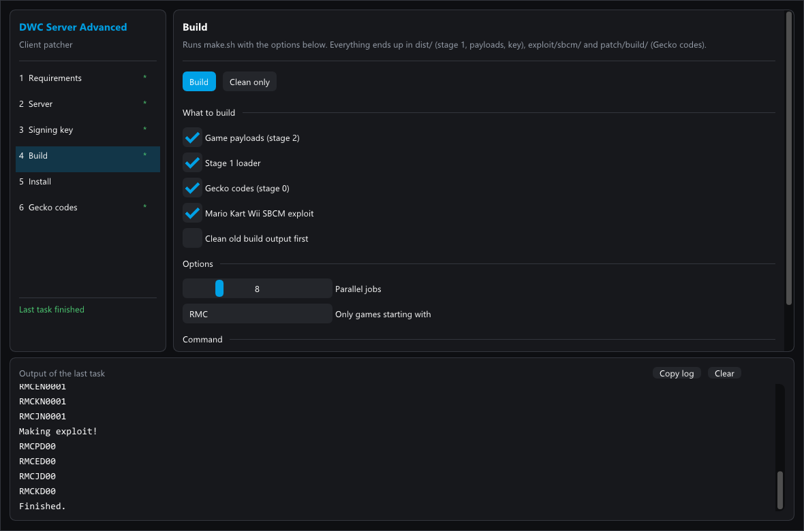
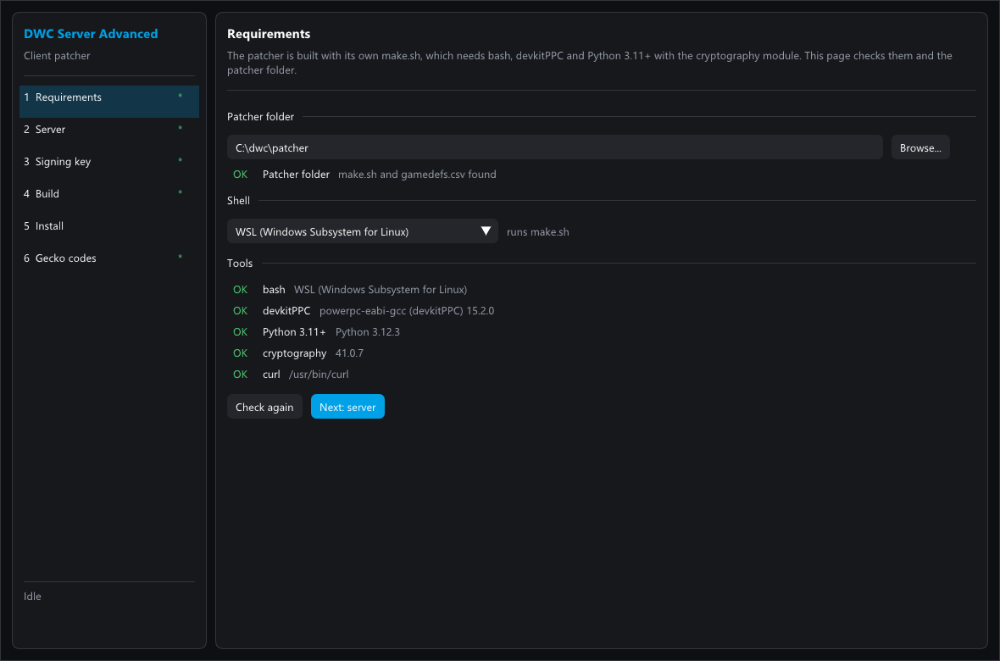
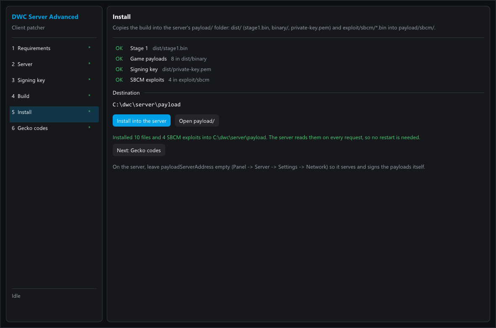
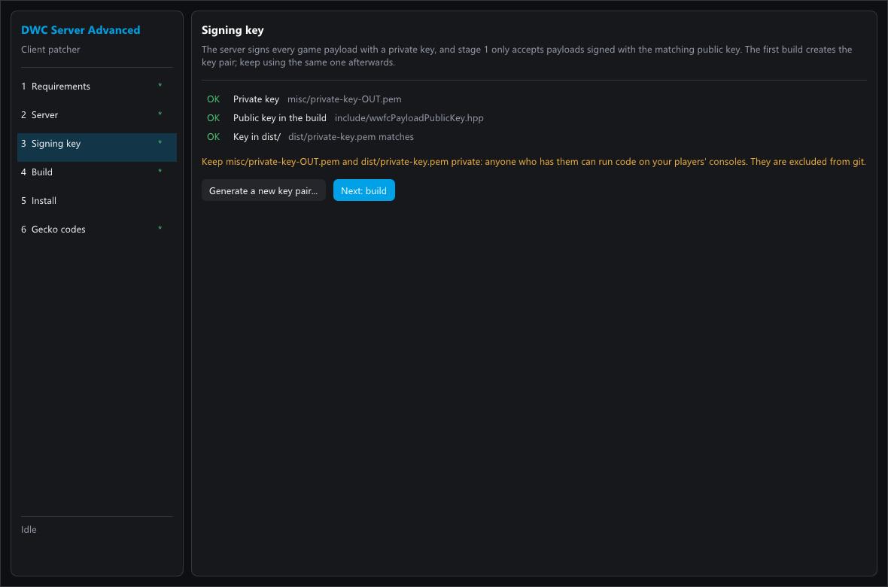
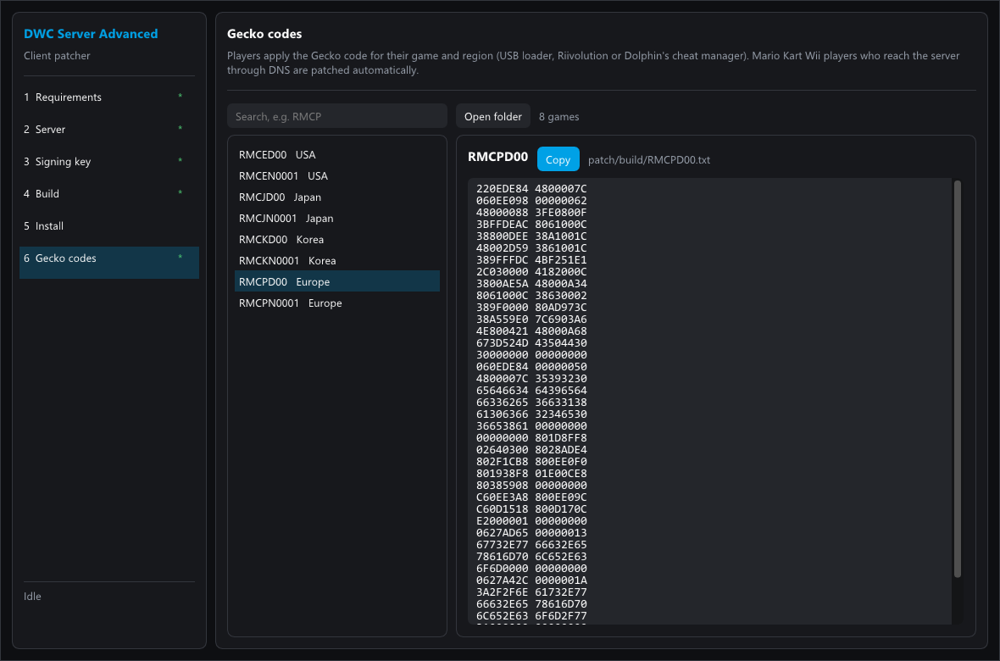

<p align="center">
  
</p>

# dwc-server-advanced-patcher

Client-side patches for **[dwc-server-advanced](https://github.com/WiiListZ/dwc-server-advanced)**, the open source replacement server for Nintendo Wi-Fi Connection. The server runs the online services; this repository builds the code that runs on the Wii and makes games connect to that server.

Mario Kart Wii's welcome popup follows the server's **Server → Settings → General** setting. When the owner turns the popup off, the server omits its message and current builds of this payload skip the popup. Rebuild and reinstall payload files after updating the patcher; previously installed payloads may still show their built-in welcome text.

> [!NOTE]
> This project is a fork of **[WiiLink24/wfc-patcher-wii](https://github.com/WiiLink24/wfc-patcher-wii)** (the WiiLink WFC Patcher) by the WiiLink team and contributors. Almost all of the code is theirs. It keeps their license, described in [License](#license).

## Contents

- [How it works](#how-it-works)
- [Changes from upstream](#changes-from-upstream)
- [Patcher GUI](#patcher-gui)
- [Requirements](#requirements)
- [Building](#building)
- [Using it with dwc-server-advanced](#using-it-with-dwc-server-advanced)
- [Checking that it works](#checking-that-it-works)
- [Repository layout](#repository-layout)
- [License](#license)

## How it works

The original Nintendo servers are gone. A game has to be patched to talk to another server, and the patch must stay small enough to type in as a Gecko code. So the patch is split into three stages. Each stage downloads the next one from your server.

```text
 Wii / Dolphin                                         dwc-server-advanced
 ─────────────                                         ───────────────────
 Stage 0  Gecko code, patched disc or launcher
          points the game at your domain  ── GET /w0 ──▶  payload/stage1.bin
 Stage 1  checks itself against a fixed hash
          asks for the game payload  ── GET /payload?g=<game> ──▶  payload/binary/payload.<game>.bin
                                                          signed on every request with
                                                          payload/private-key.pem
 Stage 2  checks the RSA signature, then patches
          the running game
```

| Stage | Directory | What it does |
|---|---|---|
| **Stage 0** | [`patch/`](patch) | The patch applied to the game. It replaces the Nintendo URLs with your domain, hooks the NAS login to run stage 1, and skips the GameSpy availability check. It is built as Gecko codes (`patch/build/*.txt`), one per game. |
| **Stage 1** | [`stage1/`](stage1) | A small loader that is the same for every game. Stage 0 downloads it from `/w0` (or `/w1`) and checks it against a hash, so it cannot be swapped. It downloads stage 2 and checks its RSA-SHA-256 signature before running it. |
| **Stage 2** | [`payload/`](payload) | One payload per game and version. It patches the running game: fixes for remote code execution bugs that other players or a server could exploit, support for the server's error messages and login popups, and general bug fixes. For Mario Kart Wii it also adds features such as Open Host and race reporting. |
| SBCM exploit | [`exploit/`](exploit) | Mario Kart Wii only. A QR2 packet that starts stage 1 inside a game that has no stage 0 patch. The server sends it during matchmaking, so unpatched clients that reach the server get patched on the fly. |
| Launcher | [`launcher/`](launcher) | A Wii channel/homebrew that boots a disc with the patches applied, as an alternative to Gecko codes. |

Every stage 2 payload is signed with the private key made by the build. Its public key is compiled into stage 1. A client only runs a payload signed with the matching key, so nobody else can serve code to your players.

## Changes from upstream

Based on upstream payload **0.3.1** ([`0d9d7a6`](https://github.com/WiiLink24/wfc-patcher-wii/commit/0d9d7a6)), which includes every upstream security patch, such as the fix for the stack overflow in `DWCi_GPRecvBuddyMessageCallback`. This fork adds:

- **Server-requested race end (Mario Kart Wii).** In the dwc-server-advanced panel, a moderator can choose **End race** on a room, and the server sends a QR2 match command (`0xFE`). The payload waits until the race has started, tries to show *"The server has decided. The race will conclude."*, and moves the race timer to the online time limit so the game ends the race. If the game puts the timer back, the payload applies it again. Each step is reported to the server as `wl:mkw_end_race`:
  - `waiting_for_race`, `server_decision_message`, `server_decision_message_failed`, `native_timeout`;
  - `finished` when the race has ended;
  - `native_timeout_failed` after 15 seconds without an end;
  - `not_in_race` when the command arrives outside a race.

  The panel shows these results. If the payload does not report `finished`, the server closes the player's connections to the room instead.
- The message of the day is shown again whenever the server sends a new one.
- `misc/generate-key.py` works with Python versions that need an explicit byte order.
- `exploit/make-sbcm-patch.py` no longer crashes with a game filter (`-gRMCP`), and also accepts a full title ID (`-gRMCPD00`).
- `.gitattributes` keeps `*.sh` with Unix line endings, so `make.sh` runs in bash even when cloned on Windows.
- A desktop GUI in `gui/` (see [Patcher GUI](#patcher-gui)).
- WiiLink's CI workflows and release settings are removed.

Upstream sometimes adds more security patches. Merge [WiiLink24/wfc-patcher-wii](https://github.com/WiiLink24/wfc-patcher-wii) regularly so your players keep them:

```sh
git remote add upstream https://github.com/WiiLink24/wfc-patcher-wii.git
git fetch upstream
git merge upstream/main
```

## Patcher GUI

`gui/` contains a desktop program, written in C++ with [Dear ImGui](https://github.com/ocornut/imgui), that does everything on this page step by step: it checks the tools, builds the patches with `make.sh` and installs them into a dwc-server-advanced server. It runs the real `make.sh` (through WSL or MSYS2 on Windows, bash on Linux and macOS), so the result is the same as building by hand, and shows its output live.



| Step | What it does |
|---|---|
| **1 Requirements** | Creates the patcher folder by downloading the v1.0.6 source archive into the chosen folder, including the GUI's own folder if selected. Existing files are preserved. Checks the shell, devkitPPC, Python 3.11+ with `cryptography` and curl, and says how to install what is missing. Finds `make.sh` checked out with Windows line endings and fixes it. |
| **2 Server** | The domain built into the patch, a test that `nas.<domain>/w0` and `/w1` answer, local `hosts` entries to copy when using `localhost`, and the server folder (the one with `config.yml`). HTTPS certificates are created in the server panel. |
| **3 Signing key** | Shows whether the key pair exists and matches the build, and generates a new one after a warning. |
| **4 Build** | Choose payloads, stage 1, Gecko codes and the SBCM exploit, the number of jobs and an optional game filter (`RMC`, `RMCP`, …). If the configured domain differs from the old build, the patcher cleans old output and requires a complete rebuild while preserving the signing key. Shows the exact `make.sh` command, its output, and can cancel. |
| **5 Install** | Checks that stage 1 and every generated Gecko code contain the configured domain, then copies `dist/` into the server's `payload/`, creates `payload/stage1v1.bin` for Gecko patches that request `/w1`, and copies `exploit/sbcm/*.bin` into `payload/sbcm/`. For a server on another machine, upload these files in its panel (**Server → Files**). |
| **6 Gecko codes** | Lists generated codes by game title, region and ID; searches all three, shows the domain built into each code, and copies the selected code for Dolphin or another cheat manager. After rebuilding, remove or disable the old code in Dolphin and enable the newly copied one. Game titles are available offline from a bundled [GameTDB](https://www.gametdb.com/Wii/Downloads) catalog. |

To set up a release binary without cloning the repository, open **Requirements** and click **Download patcher here**. The default destination is a `dwc-server-advanced-patcher` folder beside the program. You can type another path, use **Browse...**, or click **Use program folder** to put the source alongside the executable. The GUI downloads the v1.0.6 source archive using `curl` and extracts it using `tar`; both tools must be available on the machine. It accepts an existing folder containing unrelated files, but stops if a patcher source file would be overwritten. If you already cloned the repository, select that folder and continue without downloading.

The application window can be resized. Drag the dividers beside the navigation menu and Gecko code list, or above the task output, to give each panel more room. The signing-key confirmation window can also be resized.

For a server on the same PC, `localhost` by itself is not enough: the patch connects to names such as `nas.localhost` and `gs.localhost`. Windows may not resolve them until they are mapped to `127.0.0.1` in the hosts file. The Server step has **Copy local hosts entries**; paste these into the Windows hosts file with administrator rights. A successful `curl http://nas.localhost/w1` does not prove that Windows or Dolphin can resolve the name; check `ping nas.localhost` or `Resolve-DnsName nas.localhost` too. A bare IP also becomes a prefixed name (`nas.<IP>`). For a LAN server, use a local DNS name such as `wfc.home.arpa` and map `nas.wfc.home.arpa`, `gpcm.gs.wfc.home.arpa`, and the other hostnames to the server's LAN IP. The **Test the server** button checks operating-system name resolution, port 80, `/w0` and `/w1`. The Gecko patch requests `/w1`; the GUI Install step creates its file. See the server's [local setup guide](https://github.com/WiiListZ/dwc-server-advanced/blob/main/docs/LOCAL_SETUP.md) for the Windows hosts entries and [hostname list](https://github.com/WiiListZ/dwc-server-advanced/blob/main/docs/HOSTNAMES.md) for DNS overrides.

The patcher checks GitHub releases when it starts, every six hours while open, and when **Check for updates** is clicked. It shows a notice for newer versions and opens the release page for download. It does not replace a running executable automatically; settings and the patcher source folder remain in place.

For HTTPS certificates, open the server panel at **Server → Settings → HTTPS**. Save changes there, click **Generate certificate files**, then restart the server. The server also creates missing files on startup. See the server's [HTTPS certificate guide](https://github.com/WiiListZ/dwc-server-advanced/blob/main/docs/HTTPS_CERTIFICATES.md).

| | |
|---|---|
|  |  |
|  |  |

Settings are saved in `patcher-gui.ini` next to the program.

### Building the GUI

Prebuilt binaries for Windows, Linux and macOS are attached to each [release](https://github.com/WiiListZ/dwc-server-advanced-patcher/releases). To build it yourself:

The libraries (Dear ImGui 1.91.8 and GLFW 3.4) are downloaded by CMake, with fixed checksums.

**Windows** (Visual Studio 2022 or newer with *Desktop development with C++*):

```bat
gui\build-windows.bat
```

It produces `gui\build\dwc-patcher-gui.exe`, a single program without extra DLLs.

**Linux** (CMake 3.20+, a C++20 compiler and the X11/OpenGL headers, for example `sudo apt install cmake g++ libgl-dev xorg-dev`) and **macOS** (Xcode command line tools and CMake):

```sh
cmake -S gui -B gui/build -DCMAKE_BUILD_TYPE=Release
cmake --build gui/build
./gui/build/dwc-patcher-gui
```

Command line options:
- `--page <requirements|server|keys|build|install|gecko>` opens a page;
- `--run` starts that page's main action (build, server test or install);
- `--screenshot <file.bmp>` saves the window to a file and exits, without showing the window.

## Requirements

- **Python 3.11+** with the `cryptography` module (`pip install cryptography`)
- **devkitPPC** from [devkitPro](https://devkitpro.org/wiki/Getting_Started), with the `DEVKITPPC` environment variable set
- **The domain your server is reachable on** (for example `wfc.example.com`). Stage 0 contains it, so the game connects to `naswii.wfc.example.com`, `gpcm.wfc.example.com` and so on. See the server's [docs/HOSTNAMES.md](https://github.com/WiiListZ/dwc-server-advanced/blob/main/docs/HOSTNAMES.md) for the DNS records.

On Windows, build from WSL or the devkitPro MSYS2 shell.

## Building

```sh
git clone https://github.com/WiiListZ/dwc-server-advanced-patcher
cd dwc-server-advanced-patcher
DOMAIN=wfc.example.com
./make.sh --all -- -j8 -DWWFC_DOMAIN=\"${DOMAIN}\"
```

`--all` builds the payloads, stage 1 and the patches, and makes a new key pair if there is none yet. Other options:

| Option | Builds |
|---|---|
| `--keys` | A new key pair. `misc/private-key-OUT.pem` is the private key; the public key is copied to `include/wwfcPayloadPublicKey.hpp` |
| `--payload` | Stage 2 payloads into `dist/binary/` |
| `--stage1` | `dist/stage1.bin` |
| `--patch` | Gecko codes into `patch/build/` |
| `--exploit` | Mario Kart Wii SBCM packets into `exploit/sbcm/` |
| `--clean`, `--clean-keys` | Remove build output or the keys |

To build everything including the Mario Kart Wii exploit:

```sh
./make.sh --all --exploit -- -j8 -DWWFC_DOMAIN=\"${DOMAIN}\"
```

Output:

```text
dist/
  private-key.pem              signs the payloads (keep it secret)
  stage1.bin                   stage 1
  binary/payload.<game>.bin    stage 2, one per game and version
exploit/sbcm/payload.RMC*.bin  Mario Kart Wii SBCM packets (with --exploit)
patch/build/*.txt              Gecko codes for players
```

> [!WARNING]
> `dist/private-key.pem` and `misc/private-key-OUT.pem` are your signing key. Anyone who has them can run code on your players' consoles. Never commit them (`.gitignore` excludes them) and keep them only on the server. `misc/private-key-dev.pem` is the public development key from upstream and must not be used for a real server.

Keep the same key between builds. With a new key, every stage 1 and payload must be rebuilt and redeployed together.

## Using it with dwc-server-advanced

1. **Install the server** and finish its setup wizard: see the [dwc-server-advanced README](https://github.com/WiiListZ/dwc-server-advanced#installation). Point your domain's DNS records at it.

2. **Copy the build into the server's `payload/` directory.** It sits in the server's data directory, next to `config.yml`: `/var/lib/dwc-server-advanced/payload` with the Linux installer, `./data/payload` with Docker, or the folder you run the binary from.

   ```sh
   SERVER_DATA=/var/lib/dwc-server-advanced
   mkdir -p "$SERVER_DATA/payload/sbcm"
   cp -r dist/. "$SERVER_DATA/payload/"
   cp dist/stage1.bin "$SERVER_DATA/payload/stage1v1.bin"  # Gecko patches request /w1
   cp exploit/sbcm/*.bin "$SERVER_DATA/payload/sbcm/"   # Mario Kart Wii only
   ```

   The server expects this layout:

   ```text
   payload/
     private-key.pem
     stage1.bin
     stage1v1.bin
     binary/payload.<game>.bin
     sbcm/payload.RMC*.bin
   ```

   `private-key.pem` and the files in `binary/` must come from the same build, or clients reject the payload.

3. **Configure the server** in **Panel → Server**, or in `config.yml`:

   ```yaml
   payloadServerAddress: ""        # empty: this server serves and signs /payload itself
   allowNoSSLCheatClients: false   # true only for local Dolphin tests with NoSSL codes
   ```

   Set `payloadServerAddress` only if another service answers `/payload`. The server reads `/w0` from `payload/stage1.bin` and `/w1` from `payload/stage1v1.bin`.

4. **Give players the patch.** They can use the Gecko code for their game from `patch/build/` (with a USB loader, Riivolution or Dolphin's cheat manager). They can also use a disc or the launcher built from it. Mario Kart Wii players who already reach your server through DNS get patched during matchmaking by the SBCM exploit.

5. **Restart is not needed.** The server reads the files on every request. Replace them whenever you rebuild.

The server's [docs/PAYLOADS.md](https://github.com/WiiListZ/dwc-server-advanced/blob/main/docs/PAYLOADS.md) covers the client modes (NoSSL, server-injected, external payload server), the HTTPS certificates and troubleshooting.

## Checking that it works

```sh
curl -I http://nas.wfc.example.com/w1         # 200 means Gecko stage 1 is served
curl -I http://nas.wfc.example.com/w0         # 200 means SBCM stage 1 is served
```

Then connect with a patched game. In the dwc-server-advanced panel, **Live** lists the player, and for Mario Kart Wii it marks patched clients with **Payload**. The player's profile says *Payload features active*. If the game shows an error code instead, look it up on the server's `/errors` page.

Common problems:

- **Payload rejected, or the game freezes after login**: `private-key.pem` does not match the payloads or stage 1. Copy the whole `dist/` from a single build.
- **Mario Kart Wii disconnects when entering Worldwide**: the client is already patched by a NoSSL code and also receives the SBCM exploit. Use one method only (see the client modes in docs/PAYLOADS.md).
- **Game cannot connect at all**: check the DNS records and that `-DWWFC_DOMAIN` matches the server's domain.

## Repository layout

```text
patch/      Stage 0: Gecko code generator
stage1/     Stage 1: downloader and signature check
payload/    Stage 2: game payloads (security fixes and features)
exploit/    Mario Kart Wii SBCM matchmaking exploit
launcher/   Disc launcher channel
include/    Shared headers, including the payload public key
misc/       Key generation and address search tools
gui/        Patcher GUI (C++, Dear ImGui)
gamedefs.csv  Addresses of every supported game and version
make.sh     Build script
```

## License

Unless a file explicitly states otherwise, everything in this repository is licensed under a custom BSD-style license, detailed in the [LICENSE](LICENSE) file. The purpose of this license is to allow easy integration into permissively licensed projects, while requiring strict attribution to discourage implementation into the existing closed-source, proprietary environment.

The above license may not be compatible with copyleft licenses such as the GPL. For this reason, this software is also made available under the GNU General Public License version 2 (or any later version). You may choose the terms of the above license or the GPL, but not both. A copy of the GPL version 2 is available online at: https://www.gnu.org/licenses/gpl-2.0

Original work © the WiiLink team and contributors ([WiiLink24/wfc-patcher-wii](https://github.com/WiiLink24/wfc-patcher-wii)). This project is not affiliated with or endorsed by Nintendo or WiiLink.
